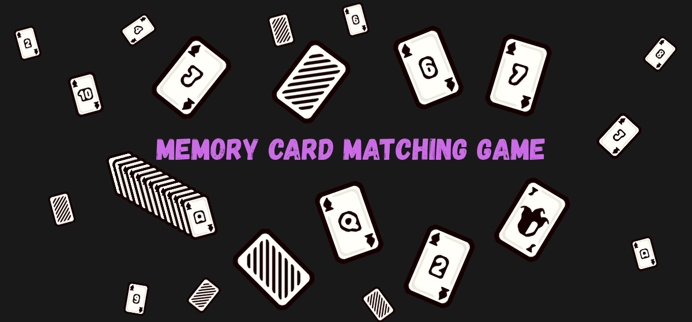

<p align="center">
  
</p>

# Memory Card Matching Game

[](https://katsumi001.itch.io/memory-card-game)

A memory matching game built with Python and Pygame. Pick a difficulty, flip cards, find pairs, and survive as the board grows from 2x2 up to 5x4, all while managing a heart-based lives system and chasing a high score.

Built while learning core game programming: game states, animation, UI systems, and persistent save data.

## Update 1

The biggest update to the game so far. Highlights:

- **Difficulty selection** — Easy, Normal, Hard, and Extreme, each with its own starting hearts (15 down to 1)
- **Score multiplier** — clear a board at full hearts and your score doubles
- **Growing board** — starts at 4 cards and scales up to 20 as you clear levels
- **A heart system that grows** — start with your difficulty's hearts, climb up to 20 by matching streaks
- **Full UI overhaul** — dealt-card animation, screen shake, particle bursts, and a proper pause menu

## How to Play

1. Pick a difficulty on the way in
2. Cards get dealt, flip up briefly, then flip back down
3. Click two cards to check for a match
4. Matches slide off; mismatches flip back after a short delay
5. Clicking during a mismatch shakes the cards, wait for them to flip back
6. Two matches in a row earns a bonus heart, up to 20
7. Clear the board and hit NEXT to keep going, the next board is bigger
8. Stuck on Easy or Normal with 1 heart left? A one-time Help button appears
9. Run out of hearts and it's game over, retry or head back to the main menu

## Download & Play

**Play on itch.io:** [katsumi001.itch.io/memory-card-game](https://katsumi001.itch.io/memory-card-game)

**Windows (no Python required):** Download `MemoryCardGame.zip` from this repo, extract it, and run `MemoryCardGame.exe`.

## Run from Source

**Requirements:** Python 3.8+ and pip

```bash
git clone https://github.com/juanmigz01/memory_card_game.git
cd memory_card_game
pip install pygame
python main.py
```

## Tech Stack

- Language: Python
- Library: [Pygame](https://github.com/pygame-community/pygame-ce)
- Data: JSON (save data and sprite sheet metadata)
- Packaging: PyInstaller (Windows build)

## Project Structure

```
memory_card_game/
├── asset/
│   ├── images/       # Card sprite sheet and metadata
│   └── sounds/       # Music and sound effects
├── card.py           # Card class: dealing, drawing, flipping, shake and slide-off animation
├── game.py           # Core gameplay loop, difficulty handling, pause menu, win/lose screens
├── effects.py         # Shared UI: gradients, panels, pill buttons, screen shake, particles
├── end.py             # Thank-you screen shown on quit
├── main.py            # Entry point, main menu, difficulty selection
├── setting.py         # Standalone settings screen (also available inline from Pause)
├── save_data.json      # Auto-generated save file
├── MemoryCardGame.zip  # Standalone Windows build
└── README.md
```

## Credits and Attributions

- Card art: [Cute Cards](https://dani-maccari.itch.io/cute-cards) by [Dani Maccari](https://dani-maccari.itch.io/)
- Sound effects and music: [Pixabay](https://pixabay.com/)

## Author

Juan Migz | Katsumi
BSIT student aspiring to become a Game Programmer, focused on building games with Unity, C#, and Python.

- GitHub: [@juanmigz01](https://github.com/juanmigz01)
- Itch.io: [katsumi001.itch.io](https://katsumi001.itch.io/)
- Email: dev.katsumi.001@gmail.com

## License

Open source and available for learning purposes. Feel free to fork it and build on it.
